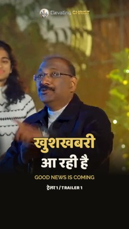

# Trailer 1 — remake for owner review

**Please watch this version and approve its lip sync, scene choices and framing before the remaining films are remade.** The three existing platform rows stay Draft. Nothing has been published to social media.

- [Watch the clean trailer](reel.mp4) · 31.33 seconds
- [Watch with source video/audio timecodes](review-timecodes.mp4)
- [One frame per second: timecoded contact sheet](contact-sheet.jpg)
- [Cover](cover.jpg) · [Phone-size cover](cover-phone.jpg)
- [Full-song shot log and seven source contact sheets](shot-log/README.md)
- [Per-shot source and audio plan](render-plan.json) · [Technical checks](checks.json)

Each visible singer retains the original audio from the same source moment. Narration and the moving 3.5-second end card use mouth-free instrument shots. The original subtitle band is removed behind the lower fade; the new Hindi/English chorus cues follow the original song lyric animation. This is a frame/timing and signal-alignment check, not an independent listening review.

1080×1920, 30 fps, H.264/AAC; measured −14.28 LUFS, −1.55 dBTP. Four exported-audio windows match the source with zero measured lag. No black intervals or audio loops. Other trailers/films are unchanged.
